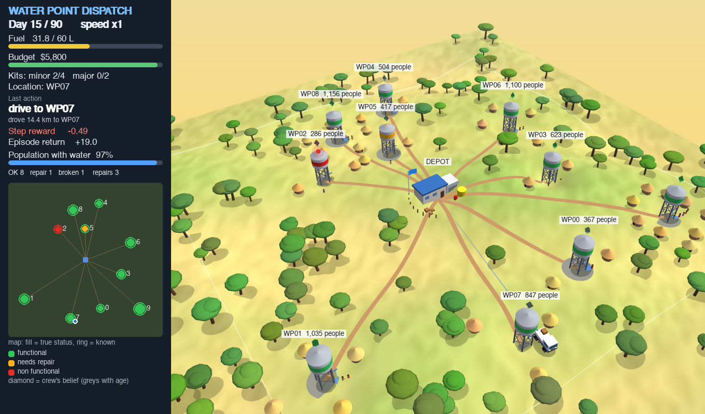
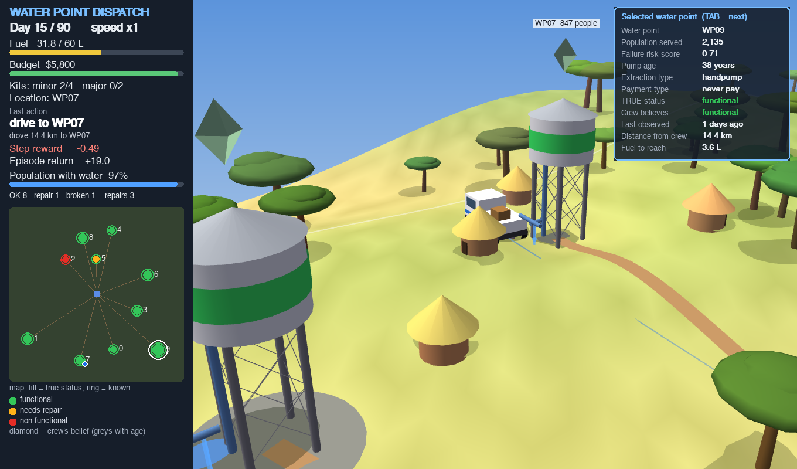
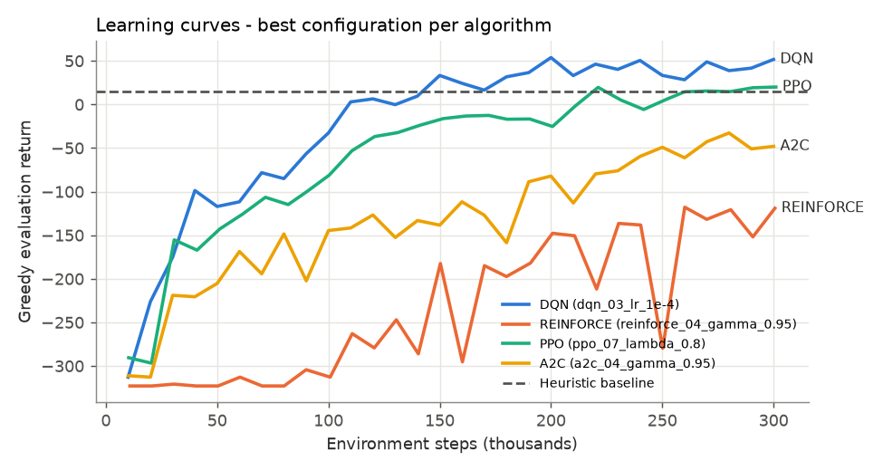

# Water Point Maintenance Dispatch — Reinforcement Learning

A reinforcement learning agent that dispatches a rural water-point maintenance crew.
It extends my capstone, which classifies the status of Tanzanian water points (the
*Pump it Up* dataset), from **predicting** which pumps fail to **deciding what to do about it**.

Four algorithms are trained with **TorchRL** on the same custom Gymnasium environment and compared:
**DQN** (value-based) and **REINFORCE, PPO, A2C** (policy-gradient).

**Video demo (5 min):** https://drive.google.com/file/d/1b7FJDYws_Z5TigKxVWl2JihTqN7kKaVu/view?usp=sharing



## The problem

One crew with a pickup truck maintains 10 water points spread over a 30 × 30 km district,
with the depot at the centre. Each point serves between 100 and 4,000 people and is
**functional**, **needs repair** or **non functional**. Points degrade every day at a rate
driven by their failure-risk score. That score comes from Pump it Up features: pump age,
extraction type and payment scheme. The crew only knows the status it **last observed**,
so it has to trade off driving, inspecting and repairing under fuel, budget and spare-part
limits, keeping as many people as possible supplied with water for 90 days.

| Component | Design |
|---|---|
| **Actions** `Discrete(15)` | 0–9 drive to water point *k* · 10 return to depot (refuel + restock kits) · 11 inspect · 12 minor repair · 13 major repair · 14 wait |
| **Observation** `Box(86,)` in [0, 1] | crew location (one-hot), fuel, budget, minor/major kits, day; per point: last known status (one-hot), days since observed, population, risk score, distance from crew |
| **Reward** | **+** restoring a point (10 per 1,000 people; half for "needs repair") · **−** 0.5 per 1,000 people without water per day (0.3× for degraded) · **−** 0.02 per km driven · **−** wasted repairs (1.5) and invalid actions (1) · **+** 0.5 × risk for inspecting a point unobserved for ≥ 7 days · **−** 30 for running out of fuel, 10 for bankruptcy, plus the remaining days of current downtime |
| **Start state** | crew at the depot with full fuel and kits and a $6,000 budget; statuses sampled from the Pump it Up distribution (54 % functional, 7 % needs repair, 38 % non functional); survey results 0–30 days old |
| **Terminal** | 90-day horizon (truncation) · fuel runs out away from the depot · budget exhausted |

A **minor repair** (1 kit, $20 labour) only fixes "needs repair". A **major repair**
(1 kit, $80 labour) fixes both. A minor kit costs $40 and a major kit $250 to restock;
fuel costs $1.50/L at 0.25 L/km with a 60 L tank.

To use the risk predictions from the capstone classifier, export a CSV with columns
`x_km,y_km,population,risk` and create the environment with
`WaterDispatchEnv(points_csv="path.csv")`.

### Visualisation

`environment/rendering.py` is an interactive 3D OpenGL scene (pygame + PyOpenGL):

- **Terrain and villages:** rolling savanna with acacia trees and dirt roads, and villages whose hut count scales with population.
- **Water towers:** the band colour is the **true** status (green / amber / red). Broken points have a flashing beacon, and working taps have villagers and flowing water.
- **Belief diamonds:** a floating diamond shows the crew's **last known** status and greys out as the information ages.
- **Truck:** spinning wheels, a dust trail and its recent route. Inspections and repairs trigger ring and spark effects.
- **HUD:** resources, the last action and its reward, % of people served, and a minimap. Click a water point to open a details panel with its features, true status vs belief, and distance.

| Control | Effect | Control | Effect |
|---|---|---|---|
| left-drag | orbit around the scene | click / TAB | select a water point |
| right-drag, W A S D | pan | F | follow the truck |
| scroll, Z / X | zoom | SPACE | pause / resume |
| Q / E, T / G | rotate, tilt | + / - | animation speed |
| R | reset camera | H / ESC | toggle help / quit |



## Results

Each algorithm's best model, evaluated on 100 unseen episodes (`uv run main.py compare`):

| Agent | Best configuration | Mean return | People-days with water | Failed episodes |
|---|---|---|---|---|
| **DQN** | lr 1e-4 | **47.6 ± 19.4** | **90.9 %** | 0 % |
| PPO | GAE λ = 0.8 | 9.8 ± 64.5 | 85.5 % | 0 % |
| A2C | γ = 0.95 | −45.8 ± 35.9 | 75.5 % | 0 % |
| REINFORCE | γ = 0.95 | −121.9 ± 38.7 | 69.6 % | 1 % |
| Rule-based heuristic | – | 14.7 ± 26.0 | 84.9 % | 0 % |
| Random | – | −232.9 ± 59.7 | 30.5 % | 79 % |



On **new random district layouts**, PPO generalises best (−42.2), while DQN drops to −153.6 because it partly memorised
the training map. Some A2C configurations learned to **reward-hack**: they strand the truck to end episodes early.
The full discussion is in the report.

## Report and beginner's guide

- [Video recording](https://drive.google.com/file/d/1b7FJDYws_Z5TigKxVWl2JihTqN7kKaVu/view?usp=sharing): 5-minute walkthrough of the problem and the trained agent running in the 3D simulation.
- `report/Mahamat_RL_Summative_Report.pdf`: the assignment report (8 pages).
- `report/RL_Beginners_Guide.pdf`: a step-by-step explanation for readers with no RL background, including the video script.

To rebuild both from the logs:

```bash
uv run --with reportlab python report/build_report.py
uv run --with reportlab python report/build_guide.py
```

## Quick start

```bash
git clone https://github.com/Mahamatbt/Mahamat_rl_summative.git
cd Mahamat_rl_summative
uv sync
uv run play.py                     # 3D simulation of the best trained agent + verbose terminal log (alias of main.py)
uv run main.py                     # same
uv run main.py --algo ppo          # a specific algorithm (dqn | reinforce | ppo | a2c | heuristic | random)
uv run main.py --no-render         # terminal only
uv run main.py compare             # evaluate all best models vs baselines, regenerate report figures
uv run pytest                      # environment, TorchRL spec and deployment API tests
```

## Using a trained agent (API)

Checkpoints (`models/<dqn|pg>/best_<algo>.pt`) contain the network weights, run config, observation/action sizes
and metrics; `deployment/api.py` rebuilds the policy from that file alone.

```python
from deployment.api import DispatchAgent
agent = DispatchAgent("dqn")
agent.recommend(obs)   # {"action": 6, "action_name": "drive to WP06", "score_type": "q_value", "scores": [...], ...}
```

```bash
uv run python -m deployment.api --algo dqn --port 8000     # JSON HTTP server (standard library only)
curl -s localhost:8000/health
curl -s -X POST localhost:8000/recommend -d '{"observation": [ ...86 floats... ]}'
```

## Training

Each algorithm has a sweep of 10 hyperparameter configurations. Every run uses the
same environment, a budget of 300k environment steps, and the same reward scaling (0.1).
A greedy evaluation runs every 10k steps on 20 held-out seeds, and the best checkpoint is kept.

```bash
uv run python -m training.dqn_training               # 10 DQN runs
uv run python -m training.pg_training --algo ppo     # 10 PPO runs (reinforce | ppo | a2c | all)
uv run python -m training.pg_training --algo a2c --runs 0 4 --frames 100000
uv run main.py train --algo all                      # all 40 runs
```

| Algorithm | Hyperparameters swept |
|---|---|
| DQN | learning rate, γ, batch size, replay buffer size, ε schedule, target update (hard/soft), double DQN, network size |
| REINFORCE | learning rate, γ, learned baseline on/off, episodes per update, entropy bonus, network size/activation |
| PPO | learning rate, γ, GAE λ, clip ε, entropy coefficient, epochs, rollout size, network size/activation |
| A2C | learning rate, γ, GAE λ, n-step rollout length, entropy coefficient, critic coefficient, advantage normalisation, network size/activation |

The sweep configurations are the `SWEEP` / `SWEEPS` lists in `training/dqn_training.py` and `training/pg_training.py`.

## Project structure

```
├── main.py                    # simulation entry point (+ train / compare subcommands)
├── play.py                    # alias of main.py: run the trained agent
├── deployment/api.py          # inference API (Python + HTTP JSON)
├── environment/
│   ├── custom_env.py          # WaterDispatchEnv (Gymnasium) + heuristic baseline
│   ├── rendering.py           # 3D OpenGL visualisation
│   └── water_points.py        # Pump-it-Up-style water points and risk model
├── training/
│   ├── common.py              # TorchRL env factory, networks, evaluation, logging
│   ├── dqn_training.py        # DQN + sweep
│   ├── pg_training.py         # REINFORCE, PPO, A2C + sweeps
│   └── evaluate.py            # comparison table and report figures
├── models/dqn, models/pg      # checkpoints; best_<algo>.pt is the best run of each sweep
├── logs/<algo>/               # learning curve CSV per run + summary.csv per sweep
├── assets/                    # screenshots and figures
├── report/                    # report + beginner's guide PDFs and their build scripts
└── tests/
```
